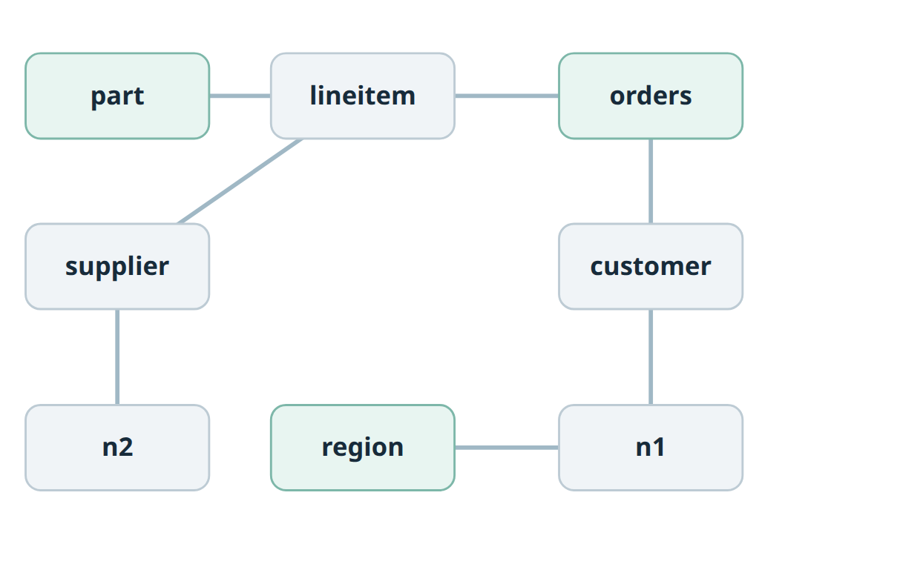
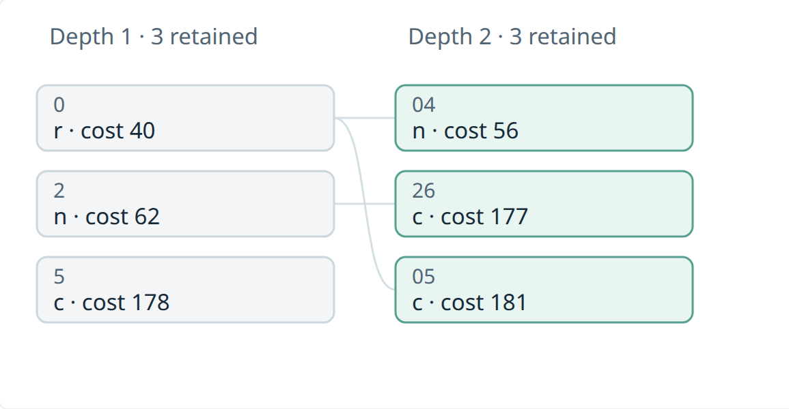

# Query Optimization in SQLite

Jashandeep Singh Bedi  
Advanced Database Management Systems  
November 2026

## 1 Research questions and findings

This project investigates how SQLite chooses a sequence of nested-loop accesses for a multi-table query. Its central contribution is a reproducible connection between the C implementation, actual GDB stops, raw optimizer decisions, and an offline visualization. The investigation uses the existing SQLite 3.54.1 debug build and TPC-H SF1 database. It does not modify the optimizer or claim a performance improvement.

The first question is how a candidate access method differs from a partial join plan. The second is how SQLite extends, compares and discards those plans. The third is whether a heuristic can change the observed search while leaving the chosen execution plan unchanged. These questions organize the progression from two-table and three-table examples to full TPC-H Query 8.

The small example provides a concrete answer. Two candidates both access region before nation, but one scans nation while the other uses the region-key index. SQLite replaces access-method sequence `02` with `04`: the estimated cost falls from 67 to 56. This replacement is visible both in the raw trace and at a breakpoint immediately before the accepted state is copied into the best-path buffer. The values are LogEst estimates, not milliseconds.

Q8 provides the larger case. Its two solver passes produce the same final access order under the default configuration and with the star-query heuristic disabled. However, the default search logs 823 path decisions, compared with 590 in the disabled run. GDB independently confirms retained-path limits of 18 and 12. The switch changes both cost estimates and breadth; this experiment therefore establishes a difference in observed search, rather than an isolated causal effect of N.

The main finding is that the final plan alone hides important optimizer behavior. An access-method replacement can preserve table order, and distinct searches can converge on the same plan. A useful visualization must preserve the distinction between access methods, partial paths, solver passes, and final execution annotations.

The assignment asks for source debugging and a theoretical explanation, with search visualization as supporting evidence. The saved artifacts make the findings inspectable and provide starting points for an independent source walkthrough and presentation.

<!-- pagebreak -->

## 2 Environment and data provenance

The implementation is pinned to SQLite 3.54.1, with source ID recorded below. The debug build uses separate C source files, `-O0 -g3`, assertions, and internal WHERE tracing. The shell executable `sqlite3d` runs the database engine; GDB controls that executable and inspects its C state. SQLite is embedded, so no separate database server is needed.

```text
2026-10-16 14:45:20 555e07ef33f69a0957d24d8e555b702464a131d6f1607f4c3c1e4551e8e6ca76
```

The existing TPC-H 3.0.1 tooling generated SF1 flat files with DBGEN. The loader adapted the schema to SQLite, retained the raw files, imported all eight tables, created the project's indexes and ran ANALYZE. The resulting database contains the following recorded row counts.

| Table | Recorded rows |
| --- | --- |
| region | 5 |
| nation | 25 |
| part | 200,000 |
| supplier | 10,000 |
| partsupp | 800,000 |
| customer | 150,000 |
| orders | 1,500,000 |
| lineitem | 6,001,215 |

The database occupies 1,444,302,848 bytes. Existing load evidence records a successful quick check and no foreign-key violations. Q8's recorded results are 0.034435890406654804 for 1995 and 0.041485521293530323 for 1996. Validation against the bundled answer was limited to two decimal places; this is not an exact arithmetic or TPC-H certification claim.

The capture script opens the database read-only and uses EXPLAIN QUERY PLAN. It hashes the database before and after all five runs; matching hashes establish that capture left this baseline unchanged. The manifest also records the binary hash, planner source hash, compile options, index SQL and TPC-H provenance. The locally calculated tooling checksum is a reproducibility record, not a comparison with an officially published checksum.

The index configuration is an explicit project choice. It includes indexes on part type, lineitem part/supplier keys, order customer/date, customer/supplier nation, and nation region. The NGQP article's historical Q8 costs and speedups are not results from this database. Its conceptual motivation is used separately from the measurements here. [1, 4]

<!-- pagebreak -->

## 3 Query workload and logical relationships

The teaching workload begins with `region JOIN nation`, then adds customer and orders along the same key chain. Each query restricts the region name to AMERICA. Keeping that predicate fixed makes changes in the number of table references easier to interpret. These queries need not be executed to observe planning.

Q8 computes the share of qualifying sales attributable to suppliers from BRAZIL, grouped by order year. The customer's nation must belong to AMERICA, the part must have the selected product type, and orders must fall in 1995 or 1996. The SQLite adaptation uses `strftime` for the year and real arithmetic for the discount expression. [4]



Figure 1. The declared SQL join graph. Edges represent equality predicates, not estimated costs. The interactive graph exposes predicates and filters on hover.

The two nation references have different meanings. `n1` is the customer's nation and connects customer to region. `n2` is the supplier's nation and supplies the market-share condition. Combining them into one node would change the query. There are eight references but seven distinct tables. Although partsupp is loaded and participates in the schema's foreign-key structure, it is not a reference in this Q8 query.

The logical graph describes which attributes relate. It does not describe the sequence of access-method candidates explored by the optimizer. An index lookup may require another reference's key, while an unconstrained scan can have no such prerequisite. Consequently, the search includes choices richer than a permutation of table names.

The original query lists part, supplier, lineitem, orders, customer, n1, n2 and region. The chosen access order differs from this textual order. The visualizer preserves the original aliases and shows the chosen nested-loop order separately, preventing a join-graph edge from being mistaken for a decision to execute its endpoint next.

<!-- pagebreak -->

## 4 The bounded search model

Nearest Neighbor keeps one promising prefix as it extends a plan. Its weakness is that an attractive early choice can lead to expensive later work. N3 retains several alternatives at each depth. N controls the breadth of this retained frontier; K is the number of table references. Increasing N can preserve a useful alternative that a narrower search loses, but N=K is not an optimality guarantee. This is the motivation described in the NGQP article. [1]

The actual representation in this investigation comes from `whereInt.h` and `wherePathSolver`. A WhereLoop is a potential way to access one FROM-clause reference. Several loops can belong to one reference: a full scan, a primary-key lookup and different index searches are distinct choices. A WherePath is an ordered array of selected loops together with a visited-reference mask, estimated output, estimated cost and ordering state. [4]

```text
frontier = one empty path
for each additional table-reference position:
    consider extensions of paths in the retained frontier
    reject already-visited references and unmet dependencies
    calculate output, execution and possible sorting estimates
    compare compatible paths for the same visited subset
    retain up to mxChoice alternatives
choose the final surviving complete path
```

This is a reading aid for the pinned C routine, not a replacement implementation. In particular, the source also checks automatic-index usefulness, preserves ordering distinctions, applies tie-breaking rules and adjusts costs. The best-path buffer is bounded across the generation rather than allocating a complete dynamic-programming entry for every possible subset. [4]

Two forms of pruning must remain separate. Access-method construction may discard a WhereLoop before path search begins. During path search, a newly extended WherePath may lose against a compatible subset competitor, or against the full frontier's worst retained path. The trace uses different record families for these activities.

The dependency test checks that all prerequisite bits are already in the prefix's visited mask. Another test prevents a reference from being added twice. A disconnected prefix is not automatically an error: scans and available predicates determine legality and estimated work. The visualization therefore checks the recorded masks instead of forbidding every prefix that appears disconnected in the logical graph. [4]

<!-- pagebreak -->

## 5 Source structures and cost estimates

The source roadmap follows planning rather than query execution. `sqlite3WhereBegin` coordinates access construction and path selection; its caller later generates bytecode that the VDBE executes. Reaching `sqlite3VdbeExec` is useful for distinguishing phases, but the enumeration questions in this report are answered inside the WHERE planner. [4]

| Symbol in where.c | Line | Role |
| --- | --- | --- |
| sqlite3WhereBegin | 6838 | Coordinates WHERE planning |
| whereLoopAddAll | 4941 | Builds access alternatives |
| whereLoopInsert | 2827 | Compares access-method candidates |
| computeMxChoice | 5663 | Sets breadth and adjusts star costs |
| wherePathSolver | 5846 | Extends and retains partial paths |
| whereInterstageHeuristic | 6313 | Restricts loops between passes |

The loop fields `rSetup`, `rRun` and `nOut` describe one-time setup, repeated access work and output per access. Path fields include `maskLoop`, `nRow`, `rCost`, `rUnsort`, `isOrdered` and `aLoop`. A path's output estimate influences the number of times a later inner access will run. A slightly more expensive access can therefore be useful if it reduces repeated work or supplies ordering. [4]

SQLite represents these estimates as approximately ten times the base-two logarithm of the underlying quantity. Adding 10 to that representation corresponds roughly to doubling the quantity. A row estimate of 26 corresponds to about 6.1 rows, while 49 corresponds to about 29.9 rows. These conversions explain scale; they do not make estimated rows into observed cardinalities.

The arithmetic needs care. Multiplying quantities corresponds to adding their logarithmic representations, while adding quantities requires `sqlite3LogEstAdd`, an approximation to a log-sum. Summing printed cost integers with ordinary arithmetic would not reconstruct the engine's total work. Sorting penalties, setup costs and small tuning biases further separate these estimates from wall-clock units. [4]

Ordering also affects equivalence. The solver compares paths covering the same reference set only under compatible ordering states, with a final-round exception. A viewer that merges all paths with the same table set, or always keeps the one with the lowest cost integer, would omit real implementation behavior. The current viewer preserves the printed ordering marker and the separate solver passes rather than implementing a second optimizer.

<!-- pagebreak -->

## 6 A worked three table search

The teaching query selects region name, nation name and customer key while filtering region to AMERICA. Its graph is a chain. The trace assigns multiple access-method IDs to the same table reference. The following are the methods present before the solver begins; masks are hexadecimal. [4, 5]

| ID | Access method | Self | Requires | Run | Output |
| --- | --- | --- | --- | --- | --- |
| 0 | r | 1 | 0 | 39 | 3 |
| 1 | r | 1 | 2 | 24 | -1 |
| 2 | n | 2 | 0 | 62 | 46 |
| 3 | n | 2 | 4 | 29 | 0 |
| 4 | n.idx_nation_regionkey | 2 | 1 | 48 | 23 |
| 5 | c.idx_customer_nationkey | 4 | 0 | 178 | 172 |
| 6 | c.idx_customer_nationkey | 4 | 2 | 131 | 125 |

The first generation retains `0`, `2` and `5`: three alternative starting references. The next generation considers combinations reachable from them. The important replacement occurs at raw trace lines 29 and 30.

```text
New    02 cost=67 , 49, 65 order=0
Update 04 cost=56 , 26, 54 order=0  was 02 cost=67 , 49, 65 order=0
```

Both candidates visit region then nation. Loop `2` scans nation, whereas loop `4` uses `idx_nation_regionkey` and requires region's bit `0x1`. Because region is already present, that prerequisite is satisfied. The indexed extension estimates lower cost and output. This is compatible-subset replacement, not eviction caused by exhausting the N=12 buffer: only three paths remain at the end of this round.

| Depth | Retained paths with cost and output LogEst |
| --- | --- |
| 1 | 0: 40, 3; 2: 62, 46; 5: 178, 172 |
| 2 | 04: 56, 26; 26: 177, 171; 05: 181, 175 |
| 3 | 046: 157, 151 |

The full solution `046` uses region, indexed nation, then indexed customer. Its estimated cost is 157. A displayed path code is a sequence of access-method labels, not table numbers. `02` and `04` are the simplest demonstration that table order alone cannot represent the optimizer's choices. The trace also rejects reversed and less useful alternatives; the final EQP independently confirms the selected access order.

<!-- pagebreak -->

## 7 Evidence from the debugger

Automated GDB sessions run the existing executable against the read-only database. Initialization and statistics loading occur before the target statement. Conditional breakpoints skip internal single-table queries. The debugger then stops in `wherePathSolver` after the path-limit calculation, where the relevant locals are initialized. [6]

The three-table capture reports the following observations. The replacement breakpoint is immediately before the chosen candidate overwrites `pTo`; it can therefore inspect both the old and new paths.

```text
PROJECT_SOLVER nLoop=3 mxChoice=12 nRowEst=0 nOrderBy=0 star=0
PROJECT_REPLACEMENT depth=2 candidate=04 old=02 newCost=56 oldCost=67
```

At the replacement stop, `pFrom->maskLoop` is 1 and `pWLoop->prereq` is also 1. The candidate's dependency is met by the existing region prefix. Its repeated-run estimate is 48 and the prefix's output estimate is 3. These field observations connect the abstract dependency and cost discussion to actual C state; they are recorded separately from the trace parser's deductions.

The backtrace includes `wherePathSolver`, `sqlite3WhereBegin` and `sqlite3Select`, then parser frames. This establishes that the observed search belongs to statement preparation and planning. EXPLAIN QUERY PLAN subsequently returns the plan description; it does not execute the selected joins over the full data in these captures.

Q8 has two stops per setting:

| Setting | Pass | mxChoice | nRowEst | nOrderBy | Star |
| --- | --- | --- | --- | --- | --- |
| Default | 1 | 18 | 0 | 0 | 1 |
| Default | 2 | 18 | 151 | 1 | 1 |
| Disabled | 1 | 12 | 0 | 0 | 0 |
| Disabled | 2 | 12 | 151 | 1 | 0 |

The second Q8 call receives row estimate 151 and one ordering term. The debugger independently verifies the source-derived limits of 18 and 12. Function-entry breakpoints alone are insufficient for this check because `mxChoice` is assigned later. The generated scripts locate their breakpoints using source fragments in the pinned checkout.

These logs were captured by automation. A live walkthrough should reproduce the stops, explain the fields and step through the conditions. The repository's study guide provides that exercise.

<!-- pagebreak -->

## 8 Q8 heuristics and solver passes

The default Q8 run exercises more than the basic N3 loop. The star-query analysis changes the unconstrained supplier index-scan estimate from 138 to 242, a delta of 104 in LogEst. The named access method is `supplier.idx_supplier_nationkey`, with no equality constraint. This matters because a scan of a covering index can also be an unconstrained scan; it should not be described as a selective lookup merely because an index name appears. [4, 5]

The pinned `computeMxChoice` returns 18 when the star heuristic is used and 12 otherwise for these multi-table cases. The name of the heuristic does not establish that every query resembles a textbook central-fact star diagram. Its implementation tests available loops and relationships; this actual Q8 run meets its criteria.

The first solver call ignores sorting cost while estimating the overall output. Between calls, `whereInterstageHeuristic` disables some unconstrained loops for references that used equality searches. The second call then considers ordering costs. In this query grouping supplies an ordering requirement, and the final plan still uses a temporary B-tree for GROUP BY. These are distinct planning passes, not two executions of Q8. [4]

| Depth | Default pass 1 | Disabled pass 1 | Pass 2 both |
| --- | --- | --- | --- |
| 1 | 8 | 8 | 2 |
| 2 | 18 | 12 | 4 |
| 3 | 18 | 12 | 6 |
| 4 | 18 | 12 | 8 |
| 5 | 18 | 12 | 7 |
| 6 | 18 | 12 | 5 |
| 7 | 8 | 7 | 3 |
| 8 | 1 | 1 | 1 |

The second pass has the same retained-count sequence under both experimental settings, although that does not imply all intermediate events or costs are identical. The first pass fills its 18-slot default frontier at several depths, while the disabled run fills a 12-slot frontier. Counts decrease near completion as alternatives cover the same remaining subsets and compatibility permits comparison.

The final access order is part, lineitem, orders, customer, n1, region, supplier, n2. EQP also reports a Bloom filter on region and the temporary grouping B-tree. These entries annotate execution; neither introduces a ninth table reference. A single flat tree of all trace lines would obscure these distinctions.

<!-- pagebreak -->

## 9 Visualizing the observed search

The visualization is a self-contained HTML file using JavaScript and SVG. Python captures SQLite's diagnostic output, converts it to schema-versioned JSON and embeds that data into the file. Opening the viewer needs no database, server, internet connection or package installation. Captures remain available as plain text and JSON for inspection outside the interface.



Figure 2. Each node is a retained access-method sequence. Edges connect a retained prefix to its extension. Earlier generations remain visible while the selected round is highlighted.

Query selection distinguishes the three learning queries and two Q8 settings. Solver-pass selection preserves the ordering-sensitive second search. Round controls move through authoritative snapshots. Candidate tables expose New, Update and Skip events, and an evidence inspector maps each selection to its loop methods, estimated costs, dependencies and raw line numbers.

The logical join graph and the retained-path graph serve different purposes. The former identifies SQL relationships and the two nation aliases. The latter represents observed optimizer state. Neither claims to display every theoretically possible plan. In particular, prerequisites can reject an extension without a path event, and paths removed from the frontier cannot be extended in later generations.

The implementation intentionally avoids fabricating eviction history. A New record can enter a non-full buffer or replace an unnamed worst entry. Round-end snapshots establish which paths actually survive. Update records identify their previous competitor explicitly, so the `02` to `04` explanation is directly supported. Access-method generation messages are shown separately from path decisions.

All fields are estimates unless explicitly labeled otherwise. Raw row estimates remain visible alongside approximate row conversions. JSON import validates the supported version and structure before replacing the displayed bundle. The local evidence has eight references at most; the browser's mask checks are not advertised as a general 64-table engine.

<!-- pagebreak -->

## 10 A controlled heuristic comparison

Question: can the star-query heuristic change the observed Q8 search without changing its final execution plan? Prediction: changing scan-cost adjustments and frontier breadth will alter intermediate candidates, while this indexed workload may still converge to the same final order. This is a testable expectation, not a guarantee of how another database or version will behave.

The experiment opens independent read-only connections. Both load the same statistics and prepare identical Q8 text. One uses the default optimizer settings; the other executes `.testctrl opt -starquery` before planning. No index, statistics or database changes occur between settings. The latter command is an internal testing interface, used here for investigation rather than as an application recommendation. [4, 5]

| Setting | N | New | Update | Skip | Total |
| --- | --- | --- | --- | --- | --- |
| Default | 18 | 199 | 154 | 470 | 823 |
| Star disabled | 12 | 161 | 96 | 333 | 590 |

The event totals count accepted New records, named Update records and logged Skip records across both solver passes. They are not unique logical plans and do not include every extension rejected by dependency checks. The default logs 233 more events. This observation establishes different visible searches; trace volume is not a direct measure of CPU work.

Both settings choose the same access-method path `08beio3m`, the same printed final cost of 222 and output estimate 150, and identical EQP output. The resulting order begins with the selective part-type access and continues through lineitem to the other keyed references. Equality of the final cost does not imply equality of all candidate estimates.

The interpretation is limited but useful. A final plan alone cannot show whether a heuristic affected the path to that plan. This experiment demonstrates such an effect on one pinned workload. It does not show that the default is faster, that disabling the heuristic is beneficial, or that either plan is globally optimal. Isolating N would require a separate implementation or control holding the cost adjustments fixed, and is outside the present scope.

<!-- pagebreak -->

## 11 Relation to classical optimization and study limits

System R organizes join optimization using dynamic programming over relation subsets, retaining useful access alternatives including interesting orders. Its cost model and join-method choices are part of the optimization problem. A common class-level comparison is therefore between a best plan per subset and property, and SQLite's bounded frontier at each prefix depth. The comparison is conceptual rather than a measurement of either implementation against the other. [7]

Cascades represents equivalent expressions in a memo, applies transformation and implementation rules, and schedules optimization tasks with required physical properties and cost limits. Volcano provided earlier foundations for this extensible approach. SQLite's local WhereLoop and WherePath structures should not be renamed as a Cascades memo: their roles and search organization differ. No Calcite execution or cross-engine cost calibration was performed in this investigation. [8]

| Approach | Main search representation | How alternatives survive |
| --- | --- | --- |
| NN | One growing loop sequence | One locally attractive prefix |
| SQLite N3 | Bounded frontier of WherePaths | Subset and ordering comparison plus N-slot capacity |
| System R | Subset plans and interesting orders | Dynamic-programming access alternatives |
| Cascades | Memo groups and optimization tasks | Rules, properties and cost-guided search |

The retained N3 frontier can lose a promising prefix, so success on Q8 does not prove optimality. An exhaustive comparison oracle is absent. A final plan can also be selected using inaccurate cardinality estimates; the current investigation explains estimates without comparing each one to observed intermediate cardinalities.

Evidence is specific to SQLite 3.54.1, the SF1 data, the selected predicates, the project's indexes, and ANALYZE statistics. The diagnostic trace format can change. The parser deliberately rejects unsupported versions rather than silently accepting a new dialect, but unrecognized non-structural diagnostic annotations are preserved without semantic interpretation.

No timing experiment was conducted. Debug builds, logging and breakpoints perturb runtime, so the event-count difference cannot be presented as a performance result. The existing Q8 answer check is limited to two decimal places. A broader follow-up could compare estimates with measured cardinalities, study controlled data skew, or isolate breadth from cost adjustments. Those investigations would need additional experimental design rather than cosmetic changes to the viewer.

<!-- pagebreak -->

## 12 Reproducibility and conclusions

From the repository root, the following commands regenerate the user-query traces, JSON and offline viewer; test the parser against saved and fresh evidence; and record debugger observations.

```bash
python3 scripts/capture_traces.py
python3 -m unittest discover -s tests -v
python3 scripts/capture_debugger.py
```

The capture command uses only Python's standard library plus the existing debug shell and database. GDB needs permission to trace its local child process. The optional browser test uses Playwright and Chrome; it exercises every run, pass and round, filters, evidence selection, import handling, mobile layout and absence of HTTP requests. It also produces the report's interface figures.

The checks validate that every represented path resolves to access methods, visits each reference at most once, satisfies prerequisites, extends a retained parent and respects the configured capacity. They compare the chosen access order with SCAN/SEARCH records in EQP. The worked small-query snapshots are also asserted against manually recorded values. These checks establish replay consistency, not a new proof of SQLite's cost model.

The primary engineering result is the reusable evidence pipeline. The explanatory result is the connection from an indexed extension replacing a scan extension, through concrete C state, to a visible search generation. The larger experiment shows that default and disabled-star searches can take different observable routes to the same final plan.

The learning workflow remains essential. The student should explain the three-table replacement, inspect live C fields, identify Q8's two nation roles, distinguish its solver passes and answer questions about pruning without AI. The repository includes a study guide and an eight-to-ten-minute demo outline to support those activities.

AI assistance was used to develop capture scripts, parser, visualization, tests, report structure and explanations. Automated checks and captured source-level observations support the numerical findings. Independent source study and rehearsal complete the learning component of the project.

<!-- pagebreak -->

## References and evidence locations

[1] SQLite developers. The Next-Generation Query Planner. https://sqlite.org/queryplanner-ng.html. Accessed November 18, 2026. Background motivation; historical example costs are separate from this project's measurements.

[2] SQLite developers. EXPLAIN QUERY PLAN. https://sqlite.org/eqp.html. Accessed November 18, 2026. Describes the diagnostic plan output and its version-dependent format.

[3] SQLite developers. The SQLite Query Optimizer Overview. https://sqlite.org/optoverview.html. Accessed November 18, 2026. Background on joins, access choices and grouping/ordering behavior.

[4] Pinned local SQLite source, version 3.54.1. See `src/sqlite-src-3540100/src/where.c`, `whereInt.h`, `sqliteInt.h` and `util.c`. The exact source ID and planner hash are in `evidence/manifest.json`. Source sections used here include access-method printing, `whereLoopInsert`, `whereLoopAddAll`, `computeMxChoice`, `wherePathSolver` and `whereInterstageHeuristic`.

[5] Captured project evidence. `evidence/project.json` contains all runs, raw lines, pass snapshots, metadata and final EQP. Individual `*.trace.txt`, `*.commands.txt` and `*.json` files preserve the capture and replay inputs. Counts in this report were generated from these records.

[6] GDB observations. `evidence/debugger/observations.json`, `join3.txt`, `q8_default.txt` and `q8_starquery_disabled.txt`. Generated command files accompany the logs. These contain real process observations, including `mxChoice` and the `02` to `04` replacement stop.

[7] P. Griffiths Selinger, M. M. Astrahan, D. D. Chamberlin, R. A. Lorie and T. G. Price. Access Path Selection in a Relational Database Management System. SIGMOD, 1979. https://web.eecs.umich.edu/~michjc/eecs584/Papers/selinger_1979.pdf.

[8] Goetz Graefe. The Cascades Framework for Query Optimization. IEEE Data Engineering Bulletin 18(3), 1995. https://15799.courses.cs.cmu.edu/spring2025/papers/05-cascades/graefe-ieee1995.pdf.

[9] Course project statement, supplied as Project Statements.pdf, project 2, and Jashandeep Singh Bedi's supplied progress notes. Used to establish assignment scope and the starting state. The notes were corrected and expanded through the local source investigation.

## Submission contents

The deliverables are the editable Word report, matching PDF, offline viewer, SQL examples, capture/parser/report scripts, curated evidence, tests, study guide and demo outline. Large data and tooling remain in their original locations and are not embedded in the viewer. No SQLite source change or public API addition is part of this project.
